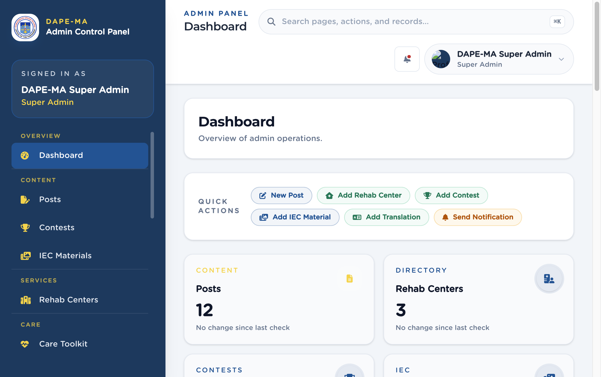

# Where to find everything

This manual is for **DAPE-MA administrators and content staff**. Use it the same way you would a desk guide: find the page in the left menu, then follow the click-this-then-that steps.

The DAPE-MA Admin Control Panel is the web workspace at `/admin`. Content you save here appears in the DAPE-MA mobile app (Android and iPhone) after the app refreshes.

| I want to… | Left menu | Chapter |
|---|---|---|
| Sign in, reset a password, or change my own profile | Sign In / account menu | 1 |
| Know who should have which role | Users | 2, 17 |
| Search, sort, or use Actions on any list | (every list page) | 3 |
| See counts and jump to a task | Dashboard | 4 |
| Write or publish a post, manage comments | Content → Posts | 5 |
| Run a song, poster, or video contest | Content → Contests | 6 |
| Add an IEC GIF, image, or YouTube clip | Content → IEC Materials | 7 |
| List a rehab facility on the map | Services → Rehab Centers | 8 |
| Edit Stress / Anxiety / Sleep questions | Care → Care Toolkit | 9 |
| Review self-care check results | Care → Care Checks | 10 |
| Update hotlines and crisis resources | Care → Care Support | 11 |
| Review journal skies and entries | Care → Journal | 12 |
| Maintain Hope partner organizations | Hope → Hope Directory | 13 |
| Publish Hope events and seminars | Hope → Hope Events | 14 |
| Send an in-app inbox campaign | Reach → Notifications | 15 |
| Read usage charts or export CSV | Reach → Analytics | 16 |
| Add a staff user or change a role | Administration → Users | 17 |
| Edit Privacy Policy, Terms, Privacy Notice, Kid Listo quotes | Administration → Settings | 18 |
| Change sky colors, feelings, and journal catalogs | Administration → Lookups | 19 |
| Change English / Filipino app labels | Administration → App Translations | 20 |
| Block a word in comments and journal text | Administration → Word Blocking | 21 |
| Fix a problem | — | 22 |
| Look up a task quickly | — | 23 |

**Figure 1.** Left menu groups (1 Overview, 2 Content, 3 Services, 4 Care, 5 Hope, 6 Reach, 7 Administration). The search bar at the top finds pages, actions, and records.

> **Important.** Trainings is not in the current left menu and is not covered here. Do not document installer database passwords, Code Snippets, or plugin updates — this is not a WordPress site.
