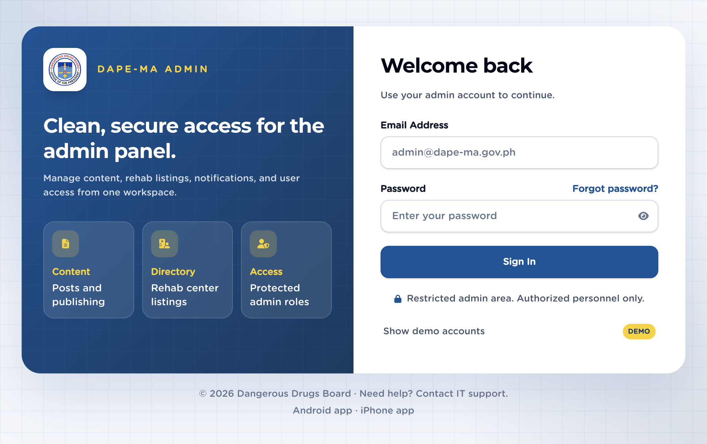
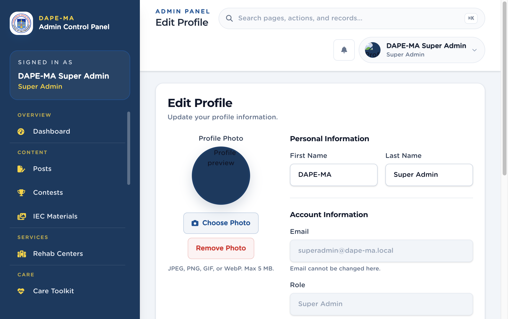

# 1. How to sign in

Open the admin sign-in page: `/admin/login`.

**Figure 2.** Sign-in screen. 1 Email Address, 2 Password, 3 Forgot password?, 4 Sign In.

## 1.1 Sign in

1. Enter your **Email Address**.
2. Enter your **Password**.
3. Click **Sign In**.
4. You land on the **Dashboard**.

If you see a 6-digit verification step, check that email inbox and type the code. Use **Forgot password?** if you cannot sign in.

> **Important.** Passwords you create or reset must include at least 8 characters, upper and lower case, a number, and a symbol. Known breached passwords are rejected. The sign-in **current password** is not checked for complexity.

## 1.2 Forgot password

1. On the sign-in screen, click **Forgot password?**
2. Enter your email and click **Send reset code**.
3. Open the email from DAPE-MA and enter the 6-digit code.
4. Set a **New password** and **Confirm new password**, then save.
5. Sign in with the new password.

## 1.3 First-time setup

**Create the first administrator** (`/admin/register`) appears only when no Super Admin exists yet. After that, new staff are added from **Users → Add User**.

## 1.4 Forced password change

If an administrator set a temporary password for you, the next sign-in opens **Edit Profile** so you can choose your own password. You cannot use the rest of the admin panel until you change it.

Passwords expire **90 days** after they were last changed. Existing accounts with no change date are not expired.

## 1.5 Edit your profile and sign out

1. Click your name and photo at the top right.
2. Click **Edit Profile** to change your photo, first name, last name, or password.
3. Click **Sign Out** when you are finished.

Email and role cannot be changed on your profile. A Super Admin changes roles on **Users**.

**Figure 3.** Edit Profile. 1 Photo, 2 First / Last name, 3 Email and role (read-only), 4 Change password.

