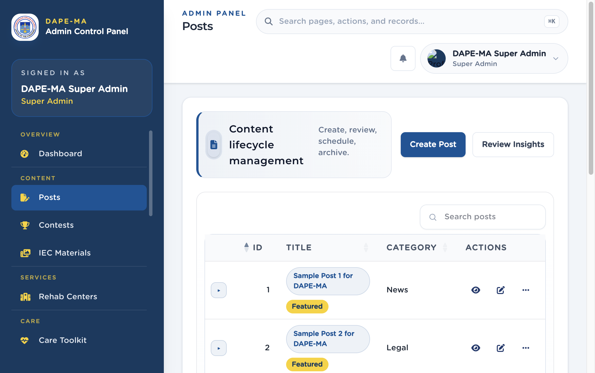

# 3. How lists work

Almost every admin page uses the same list. Learn it once.

**Figure 4.** A typical list (Posts). 1 Page title and primary button, 2 Search, 3 Sortable columns, 4 Actions (view, edit, more), 5 Rows per page.

## 3.1 Search and sort

- Type in **Search** to filter the current table.
- Click a column header (Title, Name, Date) to sort. Click again to reverse.
- Use **Show extra columns** when the table hides fields on a narrower screen.

The top search bar (**Search pages, actions, and records…** or ⌘K) searches the whole admin, not only the current table.

## 3.2 Actions column

The last column stays on the right on desktop.

- The first two icons are the main commands (often View and Edit).
- Extra commands sit under **More actions** (…).
- Hover an icon to see the tooltip (View, Edit, Delete).
- On a phone, each row becomes a card with labeled buttons.

## 3.3 Right-click / long-press

Right-click a row (or long-press on a phone) to open the same commands as the Actions column. The browser’s own menu is turned off on those rows.

## 3.4 Confirmations and toasts

- **Delete**, archive, reject, and other yes/no prompts use a confirmation dialog with Cancel and a confirm button.
- After a save or delete succeeds or fails, a **toast** appears in the corner — not another large success window.

## 3.5 Phones and small screens

On a phone (~320–430 px):

1. Tap the menu (☰) to open the left sidebar.
2. Lists switch to stacked cards so titles stay readable.
3. Buttons are large enough to tap. You do not need hover.

> **Tip.** If a page looks empty, wait a moment for the list to load, then try Search. If you still see nothing, you may not have permission for that menu.
