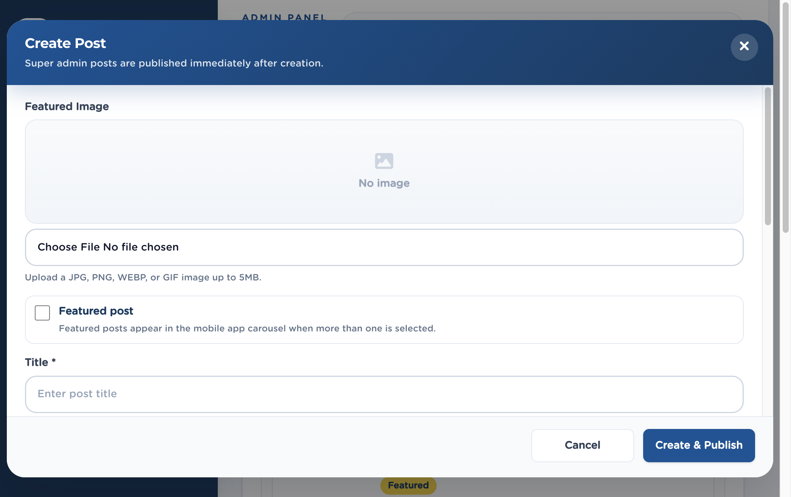

# 5. Posts

Left menu: **Content → Posts** (`/admin/posts`).

Posts are articles the mobile app shows in Home and categories. Super Admins publish immediately. Editors create drafts for review.

## 5.1 Create a post

1. Click **Create Post** (Editors see **Create Draft**).
2. Optional: choose a **Featured Image** (JPG, PNG, WEBP, or GIF, up to 5 MB).
3. Tick **Featured post** if it should appear in the mobile carousel.
4. Enter **Title**.
5. Write **Body / rich text content** in the editor (headings, bold, italic, links, numbered and bulleted lists).
6. Choose a **Category**.
7. Set **Comments** to Enabled or Disabled.
8. Optional: paste a **YouTube URL**.
9. Click **Create & Publish** (Super Admin) or **Create Draft** (Editor).

**Figure 6.** Create Post dialog. 1 Featured Image, 2 Featured post, 3 Title, 4 Body editor, 5 Category, 6 Comments, 7 Create & Publish.

> **Tip.** Super Admin posts go live as soon as you create them. Editors submit drafts; a Super Admin (or Publisher with review actions) approves, schedules, or publishes.

## 5.2 Statuses

| Status | Meaning |
|---|---|
| Draft | Not public. Keep working. |
| Pending review | Waiting for an approver. |
| Scheduled | Goes live at the date and time you set. |
| Published | Visible in the app. |
| Archived | Taken down but not deleted. |

## 5.3 View, comments, and ratings

1. Click the eye **View** action (or the title).
2. Read the post body as it will appear.
3. Open **Comments** to read user comments. Click **Delete** on a comment to remove it after confirmation.
4. Open **Ratings** and **Reactions** to see engagement.

## 5.4 Edit, schedule, archive, delete

From Actions or right-click:

- **Edit** — change title, body, image, category, comments, YouTube, featured flag, and (when allowed) status.
- **Submit** — send a draft for review.
- **Reject** — return a pending post with review notes.
- **Approve & Schedule** — pick a go-live date and time.
- **Publish now** — make it public immediately.
- **Archive** / **Delete** — confirm in the dialog.

> **Important.** Deleting a post cannot be undone. Archive if you might need it later.
