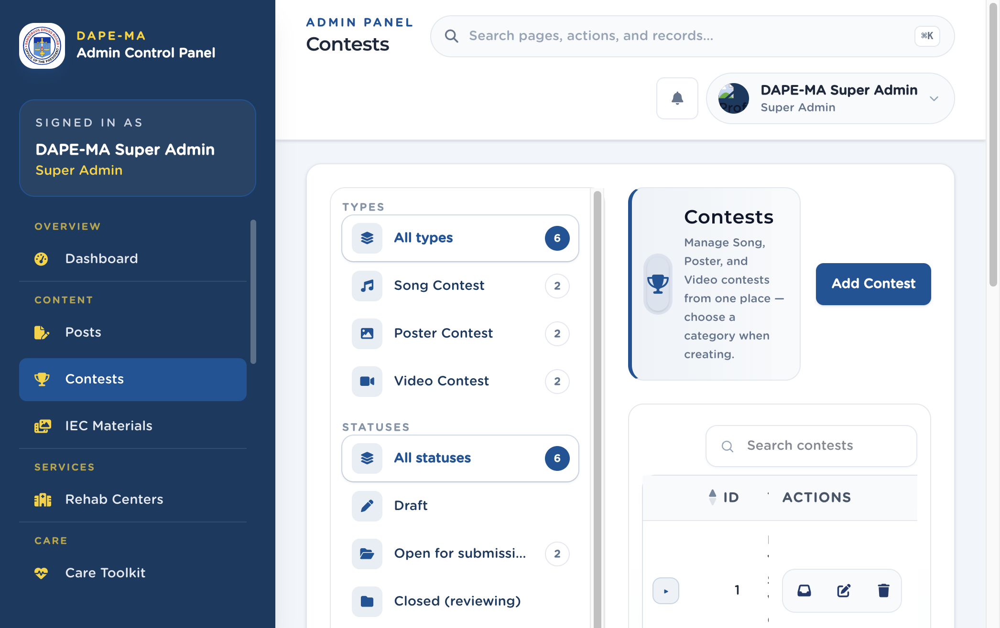

# 6. Contests

Left menu: **Content → Contests** (`/admin/contests`).

Song, Poster, and Video contests are managed on this one page. Filter by type and status on the left.

**Figure 7.** Contests. 1 Types, 2 Statuses, 3 Add Contest, 4 Search and Actions.

## 6.1 Add a contest

1. Click **Add Contest**.
2. Choose **Category:** Song Contest, Poster Contest, or Video Contest. (You cannot change category after save.)
3. For Song contests, choose allowed entry types: Song + Playlist, Song only, or Playlist only.
4. Enter **Contest title**, optional **Theme**, and **Contest year**.
5. Set **Submission starts** and **Submission ends**.
6. Set **Status** (Draft, Open for submissions, Closed (reviewing), Completed).
7. Set **Visibility** to Active in app or Hidden.
8. Add **Description** and **Contest rules** (shown on the contest detail screen).
9. Click **Create**.

## 6.2 Review submissions

1. Click the submissions / review action on the row.
2. Open an entry to view the song, poster, or video.
3. Use the status filters when judging.

## 6.3 Edit or delete

Edit from the pencil action. **Delete Contest** also deletes all submissions under it — confirm only if you mean it.
