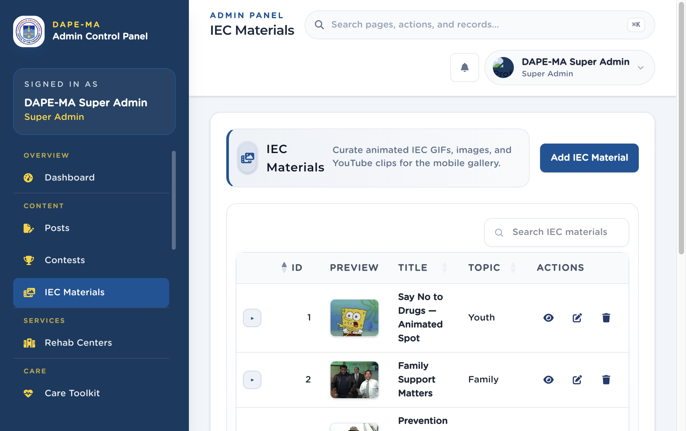

# 7. IEC Materials

Left menu: **Content → IEC Materials** (`/admin/iec-materials`).

IEC (Information, Education, and Communication) items fill the mobile gallery: animated GIFs, still images, YouTube clips, or Lottie JSON URLs.

**Figure 8.** IEC Materials list. 1 Add IEC Material, 2 Preview, title, topic, 3 Actions (preview, edit, delete).

## 7.1 Add IEC material

1. Click **Add IEC Material**.
2. Enter the title and topic (Prevention, Awareness, Youth, Family, Recovery).
3. Choose media type: Animated GIF, Image, YouTube, or Lottie JSON URL.
4. Upload the file or paste the URL.
5. Set publish / archive status as shown in the form.
6. Save. A toast confirms the item is created.

## 7.2 Preview, edit, archive

- **Preview** opens the animation or clip without leaving the page.
- **Edit** updates title, topic, or file.
- **Delete** removes it after confirmation.

> **Tip.** Keep file sizes reasonable so the app downloads quickly on mobile data.
