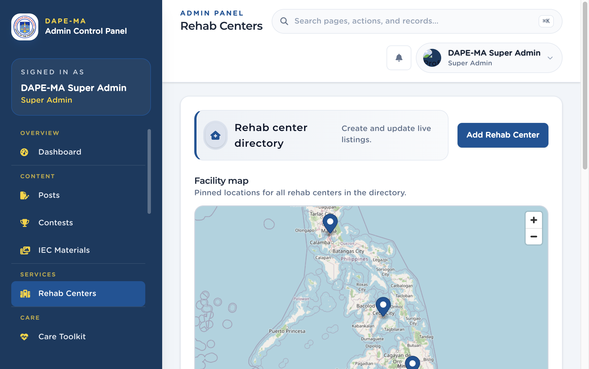

# 8. Rehab Centers

Left menu: **Services → Rehab Centers** (`/admin/rehab-centers`).

This directory drives rehab listings in the mobile app, including the map pin.

**Figure 9.** Rehab Centers. 1 Add Rehab Center, 2 Facility map with pins, 3 List below the map.

## 8.1 Add a rehab center

1. Click **Add Rehab Center**.
2. Enter **Name**.
3. Start typing in **Address**. After three characters, Philippine place suggestions appear. Click a suggestion — the field fills and the map pin moves. The suggestion list stays closed until you change the text.
4. You can also search or tap the map to drop the pin. Region and province fill from the pin.
5. Optional: **Contact** and **Website URL**.
6. Set **Status** Active or Inactive.
7. Click **Create**. You must pin a location before save.

> **Important.** Do not type a foreign address. Suggestions come from the shared Philippine map search. Phone-like contact values should be Philippine numbers when you collect a phone.

## 8.2 Edit or delete

Use **Edit rehab center** or **Delete rehab center** on the row. Deleting cannot be undone.
