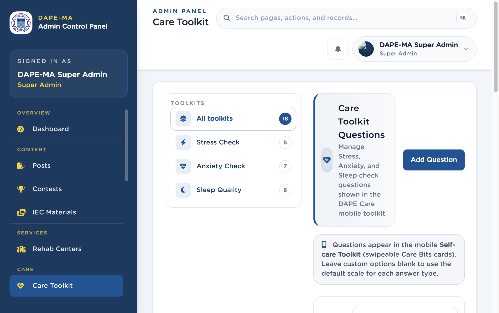

# 9. Care Toolkit

Left menu: **Care → Care Toolkit** (`/admin/care-toolkit`).

These questions power Stress, Anxiety, and Sleep checks in the mobile Self-care Toolkit.

**Figure 10.** Care Toolkit. 1 Toolkit filters, 2 Add Question, 3 Question list.

## 9.1 Add a question

1. Click **Add Question**.
2. Choose **Toolkit:** Stress Check, Anxiety Check, or Sleep Quality.
3. Choose **Answer type:** 5-point scale (Never → Very Often), 4-point scale, or Time input (HH:MM).
4. Enter **Question (English)** and **Question (Tagalog)**.
5. Optional custom options (one per line). Leave blank to use the default scale.
6. Set sort order and active status as shown.
7. Save.

Filter the list with **All toolkits**, **Stress Check**, **Anxiety Check**, or **Sleep Quality**.

> **Important.** Changing a live question changes what users see on the next check. Do not rewrite scoring scales without checking with the program owner.
