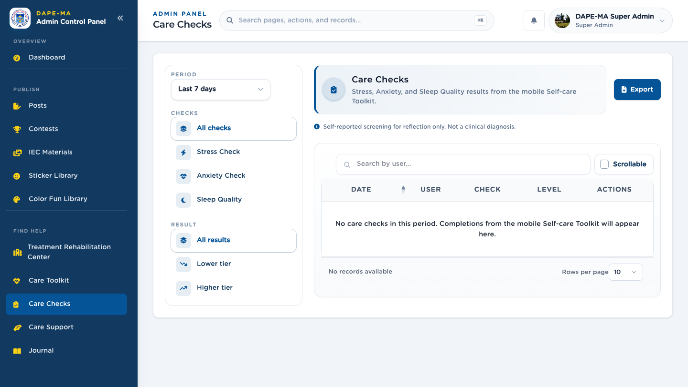

# 10. Care Checks

Left menu: **Care → Care Checks** (`/admin/care-checks`).

This page lists submitted Stress, Anxiety, and Sleep Quality results from the mobile app. It is **self-reported screening for reflection only — not a clinical diagnosis**.

Volume, mix, and trend charts for care tools live on **Analytics** (`/admin/analytics`), not on this listing.

**Figure 11.** Care Checks. 1 Period filter, 2 Export CSV, 3 Type and result filters, 4 Results table.

## 10.1 How to use the page

- Choose a **period** (7 days, 30 days, custom range, and so on) to limit the table.
- Filter by check type and lower / higher tier.
- Open a row to see the user’s result, score, answers, and date.
- Click **Export** to download a CSV of the filtered set.

Use this page to review individual completions, not to diagnose a person. Follow your office protocol if a result suggests someone may need support — point them to **Care Support** hotlines.
