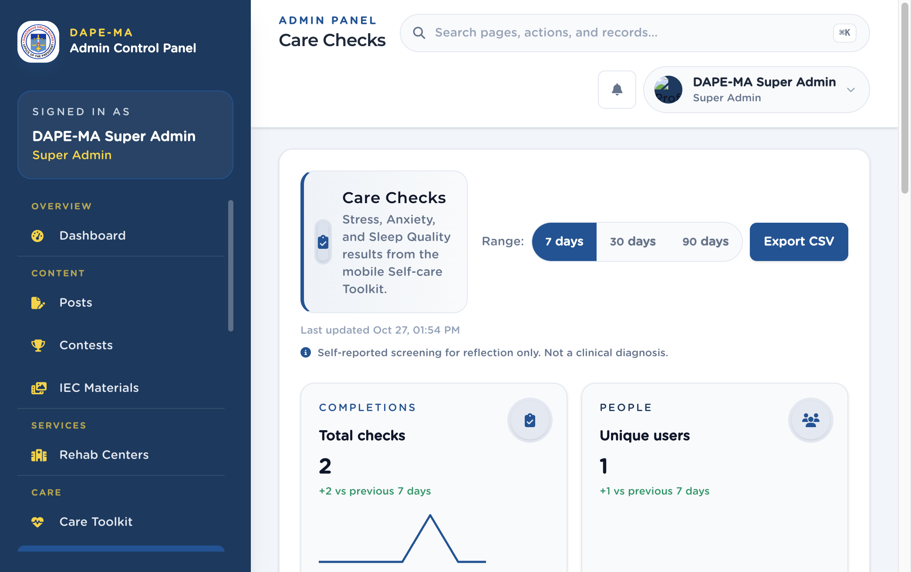

# 10. Care Checks

Left menu: **Care → Care Checks** (`/admin/care-checks`).

This page shows submitted Stress, Anxiety, and Sleep Quality results from the mobile app. It is **self-reported screening for reflection only — not a clinical diagnosis**.

**Figure 11.** Care Checks. 1 Range (7 / 30 / 90 days), 2 Export CSV, 3 Completions and people cards.

## 10.1 How to read the page

- Switch **7 days**, **30 days**, or **90 days**.
- Filter by check type and lower / higher tier.
- Open a row to see the user’s result, score, and date.
- Click **Export CSV** to download the filtered set.

Use this page to watch volume, not to diagnose a person. Follow your office protocol if a result suggests someone may need support — point them to **Care Support** hotlines.
