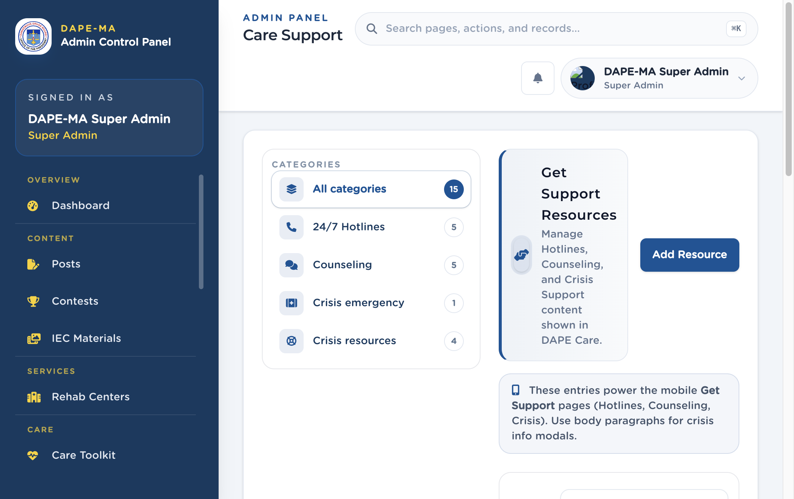

# 11. Care Support

Left menu: **Care → Care Support** (`/admin/care-support`).

Hotlines, counseling entries, and crisis resources shown in DAPE Care.

**Figure 12.** Care Support. 1 Categories, 2 Add Resource.

## 11.1 Add a resource

1. Click **Add Resource**.
2. Choose **Category:** 24/7 Hotline, Counseling, Crisis emergency banner, or Crisis info resource.
3. Enter **Title (English)** and **Title (Tagalog)**.
4. Fill role, description, website, and other fields as shown.
5. For hotlines, enter a **Philippine** phone number. Short codes such as `1553`, `911`, or `#33733` are allowed on this page. Separate several numbers with `|`.
6. Crisis resources can include modal body paragraphs (one per line).
7. Save.

> **Important.** Phone fields accept Philippine mobile and landline formats only (`09XXXXXXXXX`, `+63 …`). Do not enter a US or other country number.
