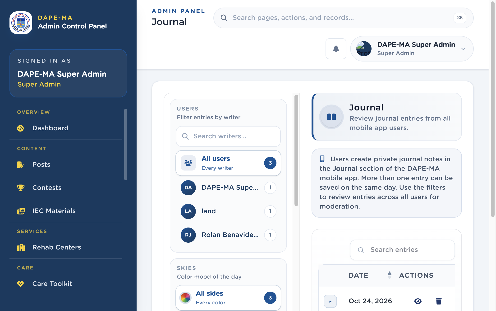

# 12. Journal

Left menu: **Care → Journal** (`/admin/diary`). Super Admin only.

Users write private journal notes in the mobile Journal. Staff use this page to review entries for moderation.

**Figure 13.** Journal. 1 Users filter, 2 Skies (color mood) filter, 3 Search entries, 4 View / delete.

## 12.1 Filter and review

1. Under **Users**, pick All users or a writer (search by name).
2. Under **Skies**, pick a color mood (or All skies).
3. Optional: switch 7 / 30 / 90 day summary range.
4. Click **View** to read the entry, sky, feelings, and notes.
5. **Delete** only when the entry must be removed. Confirm in the dialog.

Sky colors, feeling chips, and “what shaped your day” labels come from **Lookups**. If a sky color is missing in the app, add or edit it there.
