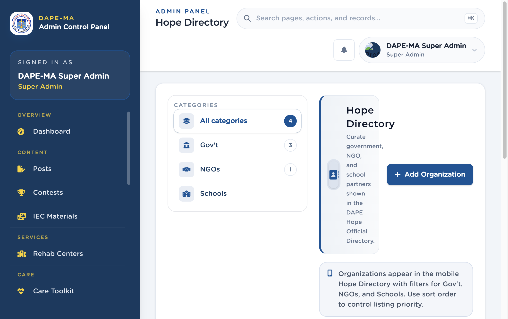

# 13. Hope Directory

Left menu: **Hope → Hope Directory** (`/admin/hope-directory`).

Government, NGO, and school partners listed in the DAPE Hope Official Directory.

**Figure 14.** Hope Directory. 1 Category filters, 2 Add Organization.

## 13.1 Add an organization

1. Click **Add Organization**.
2. Enter **Name** and optional description.
3. Choose **Category:** Gov’t, NGOs, or Schools.
4. Start typing **Address** and pick a Philippine suggestion.
5. Enter a Philippine **Phone** if you have one.
6. Optional email, logo, sort order, and Active / Inactive.
7. Save.

Sort order controls listing priority in the app. Inactive partners stay in the admin list but do not appear in the app.
