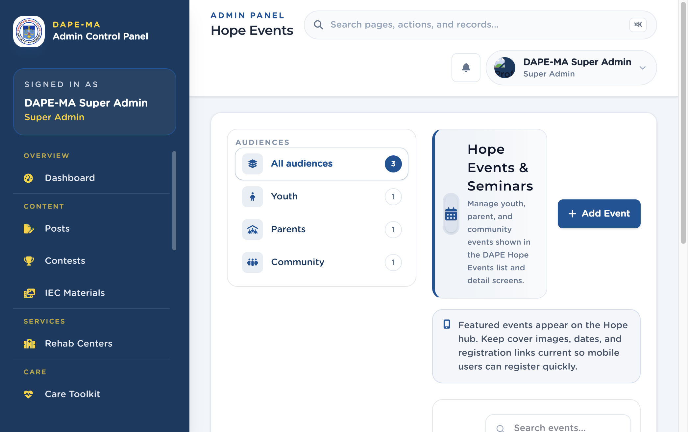

# 14. Hope Events

Left menu: **Hope → Hope Events** (`/admin/hope-events`).

Youth, parent, and community events shown in DAPE Hope.

**Figure 15.** Hope Events. 1 Audience filters, 2 Add Event.

## 14.1 Add an event

1. Click **Add Event**.
2. Enter the title, details, dates, and audience (Youth, Parents, Community).
3. Add a cover image when the form asks for one.
4. Set slots, registration link, featured flag, and Active / Hidden as shown.
5. Save.

Featured events appear on the Hope hub. Keep dates and registration links current.

Some events include a **Share** action for a public link. Use it only when your office wants the event on the web.
