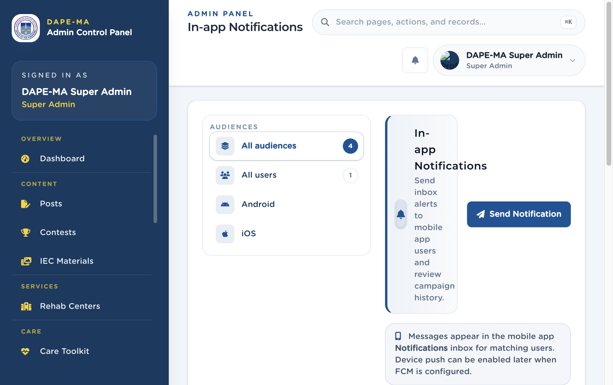

# 15. Notifications

Left menu: **Reach → Notifications** (`/admin/notifications`).

Send inbox alerts to mobile app users and review campaign history.

**Figure 16.** Notifications. 1 Audience filters, 2 Send Notification.

## 15.1 Send a campaign

1. Click **Send Notification**.
2. Enter **Title** and **Message body**.
3. Optional: link a **Related Post**.
4. Choose **Audience:** All Users, Android Users, or iOS Users.
5. Confirm send.

Messages appear in the mobile **Notifications** inbox for matching users. Device push can be enabled later when FCM is configured.

## 15.2 History

Filter by audience. **View** opens the campaign. **Delete** removes it from history after confirmation.
