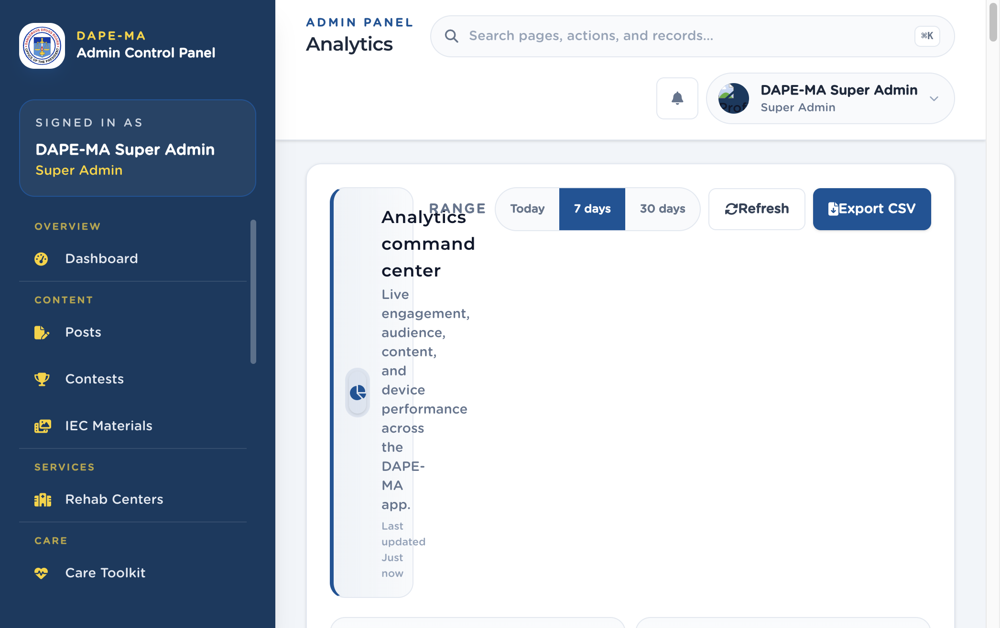

# 16. Analytics

Left menu: **Reach → Analytics** (`/admin/analytics`). Super Admin and Analytics Viewer.

**Figure 17.** Analytics command center. 1 Range (Today / 7 days / 30 days), 2 Refresh, 3 Export CSV.

## 16.1 What the numbers mean

| Card | Meaning |
|---|---|
| Total events | All tracked actions in the range. |
| Views | Post and content views. |
| Unique users | Signed-in people who generated at least one event. |
| Engagement rate | Bookmarks + shares divided by views. |
| Sessions, bookmarks, searches, shares, reviews | Counts for those actions. |
| Avg rating | Average stars across rated posts. |

Further down: daily activity, hourly heatmap, events by type, engagement funnel, device breakdown (Android / iOS / web), top viewed and top rated posts, top categories, weekday performance, rating distribution, and a live recent-activity feed.

## 16.2 Export

1. Click **Export CSV**.
2. Choose Today, Last 7 days, or Last 30 days.
3. Click **Download CSV**.
