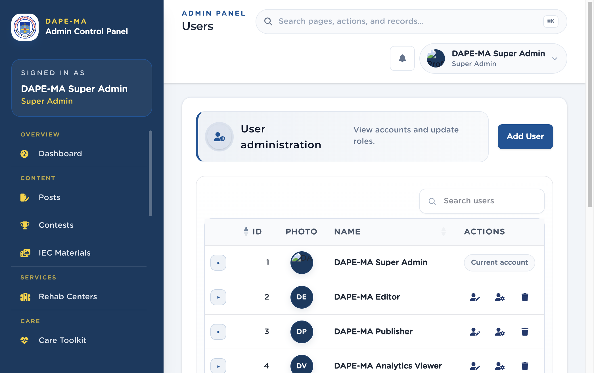
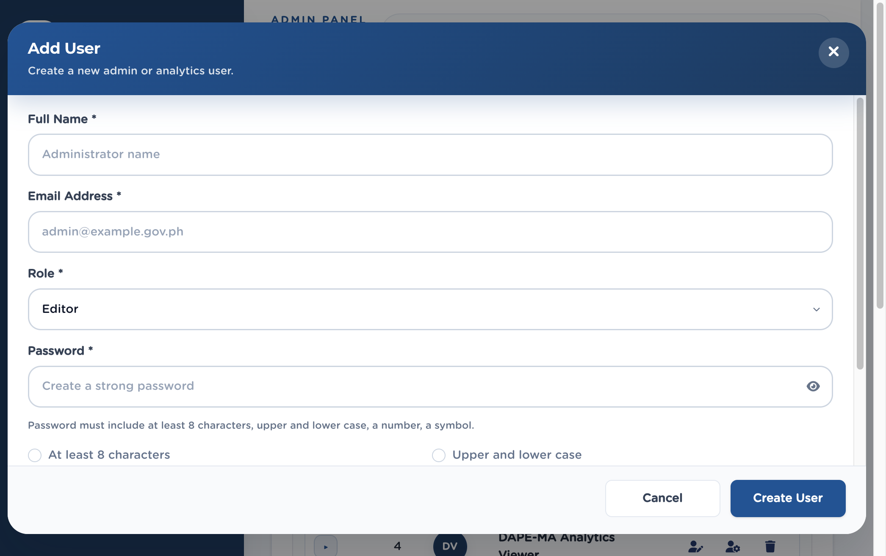

# 17. Users

Left menu: **Administration → Users** (`/admin/users`). Super Admin only.

**Figure 18.** Users list. 1 Add User, 2 Search, 3 Actions (Edit, Change Role, Delete). Your own row shows Current account.

## 17.1 Add a user

1. Click **Add User**.
2. Enter **Full Name** and **Email Address**.
3. Choose **Role** (see the table in chapter 2).
4. Enter **Password** and **Confirm Password** that meet the hint: at least 8 characters, upper and lower case, a number, a symbol.
5. Click **Create User**.

The new person must change that password on first sign-in.

**Figure 19.** Add User dialog. 1 Name, 2 Email, 3 Role, 4 Password and policy checklist, 5 Create User.

## 17.2 Edit, change role, delete

- **Edit User** — name, email, optional new password (leave blank to keep the current password).
- **Change Role** — pick Super Admin, Editor, Publisher, Analytics Viewer, or App User.
- **Delete User** — permanent. You cannot delete your own account.

> **Important.** App User is for mobile accounts listed here, not for staff who need the admin panel.
