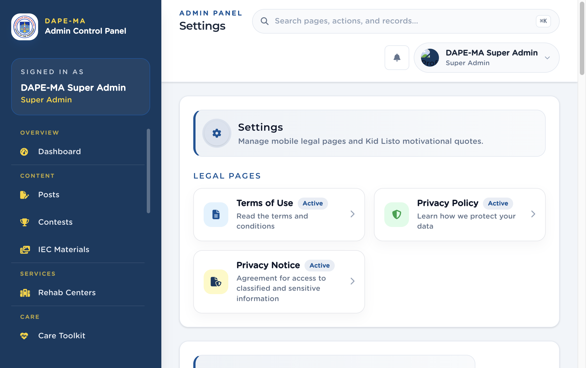

# 18. Settings

Left menu: **Administration → Settings** (`/admin/settings`).

Legal pages for the mobile Settings screens, plus Kid Listo quotes.

**Figure 20.** Settings. 1 Terms of Use, 2 Privacy Policy, 3 Privacy Notice, 4 Kid Listo Quotes (below).

## 18.1 Legal pages

1. Click **Privacy Policy**, **Terms of Use**, or **Privacy Notice**.
2. Edit **Title** and **Subtitle** in English and Tagalog.
3. Edit **Body (English)** and **Body (Tagalog)** in the same rich-text editor used for posts (headings, bold, lists, links).
4. Set Active or Hidden.
5. Save. Updates appear in the mobile Settings screens.

> **Important.** Body fields are not a plain text box. Numbered lists must show 1, 2, 3 in the editor and in the app.

## 18.2 Kid Listo quotes

1. Click **Add Quote**.
2. Enter the quote in English and Tagalog, optional attribution, and active status.
3. Save. Quotes appear randomly on the mobile Kid Listo screen.

Edit or delete from the quotes table Actions.
