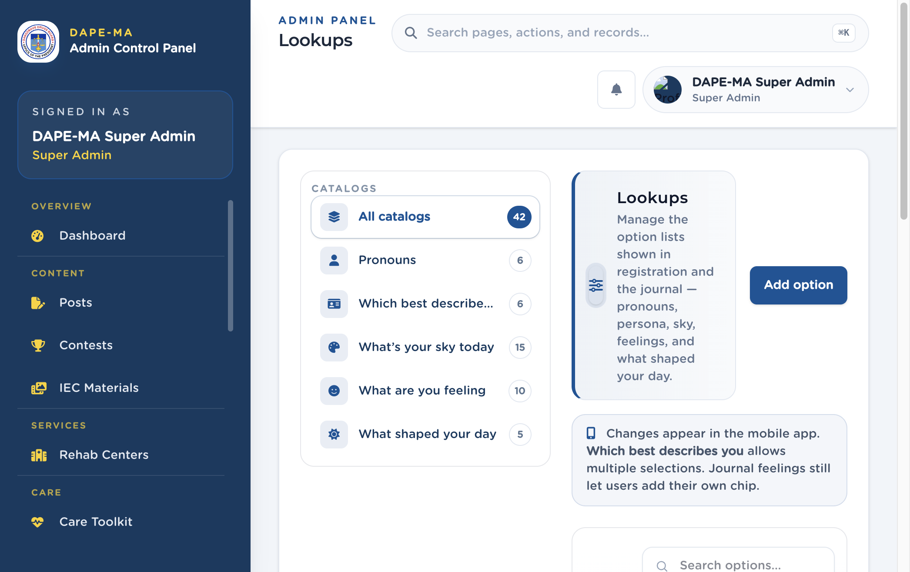

# 19. Lookups

Left menu: **Administration → Lookups** (`/admin/lookups`).

Option lists used in registration and the journal: pronouns, persona, sky colors, feelings, and what shaped your day.

**Figure 21.** Lookups. 1 Catalogs, 2 Add option.

## 19.1 Add or edit an option

1. Pick a catalog on the left (or All catalogs).
2. Click **Add option** (or Edit on a row).
3. Enter **Label (English)** and **Label (Tagalog)**.
4. Optional subtitle (shown under sky color names in the app).
5. Optional **Icon** — if you set an icon on a sky color (for example Red / sky_red), the mobile journal shows it.
6. **Accent color** is used when a feeling chip is selected.
7. Save.

> **Tip.** Unselected feeling chips stay a default color. The accent applies only when the user selects that feeling.
