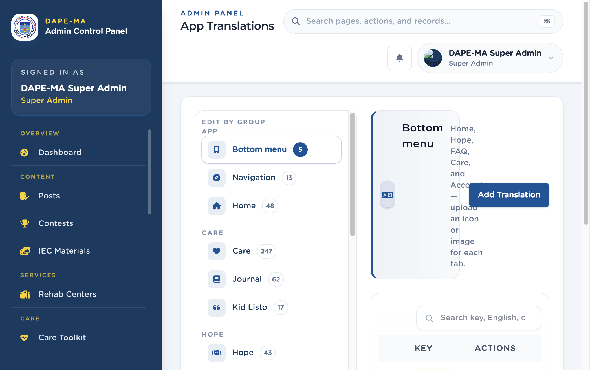

# 20. App Translations

Left menu: **Administration → App Translations** (`/admin/app-translations`).

English and Filipino labels for **app chrome** (buttons, titles, empty states). This is not where you write post body or Kid Listo quote text.

**Figure 22.** App Translations. 1 Groups, 2 Add Translation, 3 Key list.

## 20.1 Edit a string

1. Click a group (Bottom menu, Navigation, Home, Care, Journal, Hope, and so on).
2. Search by key, English, or Filipino.
3. Click **Edit**. Change English and Filipino. The **key** is locked after create.
4. Save. The live app picks up catalog changes on launch, about every 20 seconds, and when the app returns to the foreground.

## 20.2 Add a translation

Use **Add Translation** only when a new app label needs a key. The key must match the name used in the app. Do not invent keys for CMS post body.

Bottom menu keys can include an icon or image for each tab.
