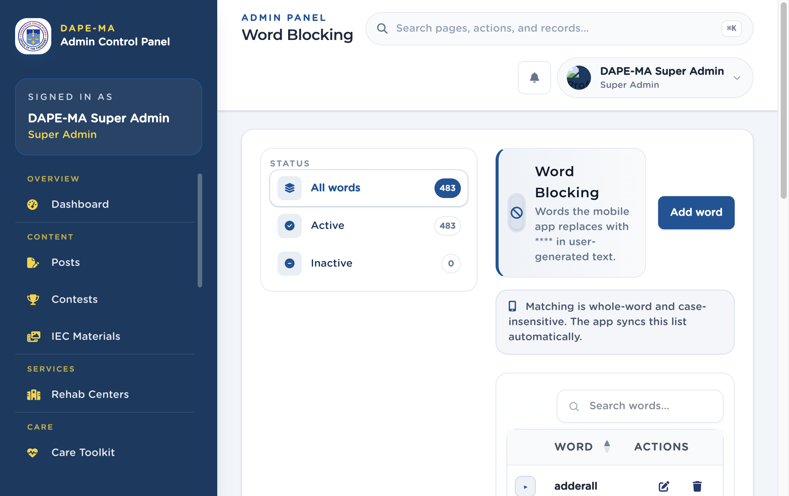

# 21. Word Blocking

Left menu: **Administration → Word Blocking** (`/admin/word-blocking`).

Words the mobile app replaces with `****` in comments, journal notes, profiles, and other user text. Matching is whole-word and case-insensitive. The app syncs this list automatically.

**Figure 23.** Word Blocking. 1 Status filters, 2 Add word, 3 Word list.

## 21.1 Add a blocked word

1. Click **Add word**.
2. Type the word (at least 2 characters).
3. Set **Active** or **Inactive**.
4. Save.

Edit or delete from Actions. Inactive words stay in the list but are not applied.
